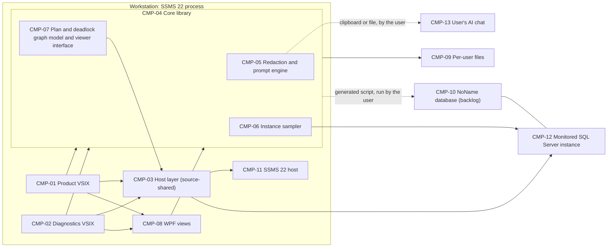
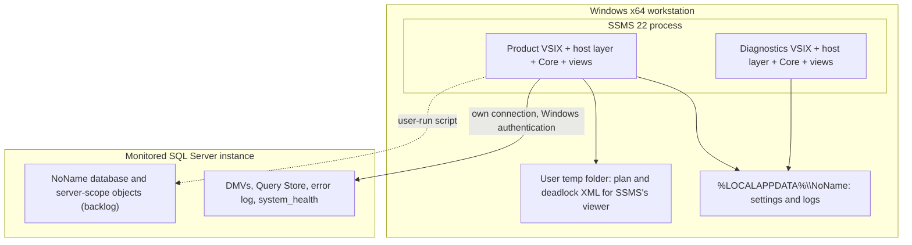

# ARCH-001 — NoName architecture

## 1. Context and scope

NoName (a working slug; the product name is Q-NN-001) is an SSMS 22 extension suite for a DBA working on one SQL Server instance. It reads the instance's own data (DMVs, Query Store, the error log and system_health) in one light tool window per instance, and turns a query, error, plan, deadlock or row into an AI prompt. The prompt is built and redacted locally, then copied or saved by the user for whatever AI chat their organization allows. NoName Diagnostics, the SSMS-update canary, is kept alongside the product.

Inside the system: the product VSIX and the Diagnostics VSIX, the late-bound host layer they share, the Core library (redaction and prompt engine, instance sampler, plan and deadlock graph model, view models, settings, probe catalog, generated install scripts), the WPF views, the per-user files on the workstation, and, in the backlog only, the NoName database on the instance. Outside it: SSMS 22 itself (its editor, connection, viewers and bundled ScriptDom), the monitored SQL Server instance, and the user's AI chat, which NoName never calls (NFR-004). Monitoring many servers, an MCP channel and an administrator-managed redaction policy are out of scope (PRD-001 section 4).

Defined against PRD-001 version 3, status draft (versions 1 and 2 of this description were defined against PRD-001 version 2). The result is a proposal while the PRD may still change. The operating context is `production`, from the PRD.

Inspection scope, named by Bryan Ankielewicz on 2026-11-06: `src/`, `docs/specs/brainstorm/BRN-001.md`, `docs/specs/design/DSN-001.md` and `docs/specs/noname/`. Nothing outside it was read beyond the documents read by contract.

## 2. Quality drivers

- **The host** (NFR-001, NFR-002, NFR-003, NFR-006, NFR-014, NFR-038, NFR-044, NFR-045): an unsupported, often-updated SSMS 22 on .NET Framework 4.8, x64. SSMS types are bound late, ScriptDom is SSMS's own, a broken API disables only its feature and says why, and the logic sits in a library with no SSMS reference under the 95% gate. These shape CMP-01 to CMP-04 and ADR-001, ADR-006 and ADR-008.
- **Privacy and security of what leaves the machine** (NFR-004, NFR-007, NFR-008, NFR-010 to NFR-013, NFR-041, NFR-048): no AI calls, no telemetry, no stored prompts or secrets, values logged as shapes, secrets always redacted, and plan and deadlock XML kept in a local temp file. These shape CMP-05, CMP-07 and CMP-09 and ADR-001, ADR-002 and ADR-007.
- **Lightness** (NFR-018, NFR-019, NFR-020, NFR-031, FR-038): nothing heavy on the UI thread, first paint within 500 ms from cached data, one measured poll cost. These shape CMP-06 and CMP-08 and ADR-005 and ADR-006.
- **Connections and permissions** (NFR-009, NFR-015, NFR-032, NFR-035, NFR-040, NFR-046, NFR-049): Windows authentication only for the extension's own connection, stated states instead of dialogs, and only VIEW SERVER STATE and VIEW DATABASE STATE for the read-only tools. These shape CMP-03, CMP-06 and CMP-12 and ADR-010 (which supersedes ADR-003).
- **Look and accessibility** (NFR-022 to NFR-030, NFR-042): the Visual Studio 2026 shell's tokens and themes, status as icon plus word, table views, keyboard and screen readers, restrained motion. These shape CMP-08 and ADR-006.
- **Observability** (NFR-016, NFR-034): the JSON Lines session log and its redacted copy. These shape CMP-02 and CMP-09.
- **Compliance** (NFR-017): no copied third-party code.

All eight categories of the `production` floor (constraint, security, privacy, reliability, observability, compliance, performance, accessibility) have at least one NFR in PRD-001, so no required category is uncovered.

## 3. Components



```yaml items
components:
  - id: CMP-01
    status: active
    name: "Product VSIX"
    kinds:
      - "user-interface"
      - "platform"
    responsibility: "Loads the product package in SSMS 22, registers its commands and tool windows (the instance window and the prompt hub), catches every exception at each command boundary, and runs the Core probe catalog as a self-check after an SSMS update. Holds no logic of its own beyond wiring; not the canary."
    owns_data: []
    interacts_with:
      - "CMP-03"
      - "CMP-04"
      - "CMP-08"
    deployment: "Per-user VSIX for SSMS 22 [22.0,23.0) on amd64, installed with SSMS's own VSIXInstaller (ADR-008)"
    upstream:
      - {id: PRD-001, item: NFR-001, relation: informed_by, version: 2, hash: null}
      - {id: PRD-001, item: NFR-002, relation: informed_by, version: 2, hash: null}
      - {id: PRD-001, item: NFR-006, relation: informed_by, version: 2, hash: null}
      - {id: PRD-001, item: NFR-014, relation: informed_by, version: 2, hash: null}
      - {id: PRD-001, item: NFR-038, relation: informed_by, version: 2, hash: null}
  - id: CMP-02
    status: active
    name: "NoName Diagnostics VSIX"
    kinds:
      - "user-interface"
      - "platform"
    responsibility: "The SSMS-update canary: runs every probe on demand, streams the session log live in its tool window, logs the per-probe run summary and offers Copy redacted log. Installs and runs on its own, so a broken product build can't hide an SSMS break; not part of the product's features."
    owns_data: []
    interacts_with:
      - "CMP-03"
      - "CMP-04"
      - "CMP-08"
    deployment: "A separate per-user VSIX for SSMS 22, built from the same solution with the same version number (ADR-008)"
    upstream:
      - {id: PRD-001, item: NFR-016, relation: informed_by, version: 2, hash: null}
      - {id: PRD-001, item: NFR-034, relation: informed_by, version: 2, hash: null}
      - {id: PRD-001, item: NFR-045, relation: informed_by, version: 2, hash: null}
  - id: CMP-03
    status: active
    name: "Late-bound host layer"
    kinds:
      - "platform"
    responsibility: "The only code that touches SSMS internals: loads every SSMS and Copilot type by name (query editor text and selection, window connection info and SPID, new query windows, SSMS's plan and deadlock viewers, the bundled ScriptDom behind Core's parser interface), opens the extension's own Windows-authenticated connection with the window's settings, and verifies it reached the window's server and replica. Reports a missing type as a disabled feature naming its probe; holds no product logic."
    owns_data: []
    interacts_with:
      - "CMP-11"
      - "CMP-12"
      - "CMP-04"
    deployment: "Source-shared into both VSIXs (a shared project) or compiled under a per-VSIX assembly name, never one shared assembly (ADR-008)"
    upstream:
      - {id: PRD-001, item: NFR-003, relation: informed_by, version: 2, hash: null}
      - {id: PRD-001, item: NFR-006, relation: informed_by, version: 2, hash: null}
      - {id: PRD-001, item: NFR-014, relation: informed_by, version: 2, hash: null}
      - {id: PRD-001, item: NFR-045, relation: informed_by, version: 2, hash: null}
      - {id: PRD-001, item: NFR-046, relation: informed_by, version: 2, hash: null}
  - id: CMP-04
    status: active
    name: "Core library"
    kinds:
      - "service"
    responsibility: "All testable logic, with no SSMS reference: the view models for every window (MVVM), the probe catalog and runner, the session log and sanitizer, settings reading and writing, and generation of install, upgrade and drop scripts from resources. Contains CMP-05, CMP-06 and CMP-07. Never touches SSMS types or the UI thread."
    owns_data:
      - "Probe catalog and run summaries"
    interacts_with:
      - "CMP-03"
      - "CMP-08"
      - "CMP-09"
    deployment: "netstandard2.0 assembly shipped in both VSIXs and loaded in SSMS's process; how it avoids the two-VSIX collision is named by the first packaging epic (ADR-008)"
    upstream:
      - {id: PRD-001, item: NFR-012, relation: informed_by, version: 2, hash: null}
      - {id: PRD-001, item: NFR-017, relation: informed_by, version: 2, hash: null}
      - {id: PRD-001, item: NFR-018, relation: informed_by, version: 2, hash: null}
      - {id: PRD-001, item: NFR-044, relation: informed_by, version: 2, hash: null}
  - id: CMP-05
    status: active
    name: "Redaction and prompt engine"
    kinds:
      - "service"
      - "api"
    responsibility: "Pure functions: a string and a context in, a redacted string and a mapping out, with no SSMS and no I/O. Parses T-SQL through Core's parser interface, reads plan and deadlock XML element by element, applies the user's preset, builds the prompt and the receipt (counts and a hash). Holds prompts in memory only; doesn't read the connection or write the clipboard."
    owns_data:
      - "Redaction mappings and prompts, in memory only until copied, saved or closed"
    interacts_with:
      - "CMP-04"
      - "CMP-07"
    deployment: "Part of the Core library (ADR-001)"
    upstream:
      - {id: PRD-001, item: NFR-004, relation: informed_by, version: 2, hash: null}
      - {id: PRD-001, item: NFR-010, relation: informed_by, version: 2, hash: null}
      - {id: PRD-001, item: NFR-013, relation: informed_by, version: 2, hash: null}
      - {id: PRD-001, item: NFR-041, relation: informed_by, version: 2, hash: null}
  - id: CMP-06
    status: active
    name: "Instance sampler"
    kinds:
      - "service"
    responsibility: "One per instance window: polls the instance at 5 seconds or slower in one batch with multiple result sets, measures its own session's cost in the same batch, keeps ring buffers per counter, runs the always-on base section (KPI strip and time brush) and the sections tabs subscribe to, and stops while the window is hidden. Nothing else polls; it doesn't draw."
    owns_data:
      - "In-session samples and ring buffers per counter"
    interacts_with:
      - "CMP-03"
      - "CMP-04"
      - "CMP-12"
    deployment: "Part of the Core library, running on a background thread (ADR-005)"
    upstream:
      - {id: PRD-001, item: NFR-015, relation: informed_by, version: 2, hash: null}
      - {id: PRD-001, item: NFR-019, relation: informed_by, version: 2, hash: null}
      - {id: PRD-001, item: NFR-020, relation: informed_by, version: 2, hash: null}
      - {id: PRD-001, item: NFR-031, relation: informed_by, version: 2, hash: null}
  - id: CMP-07
    status: active
    name: "Plan and deadlock graph model and viewer interface"
    kinds:
      - "service"
      - "api"
    responsibility: "Parses ShowPlan XML and deadlock XML into graph models from day one (operators, warnings, estimated against actual rows; processes, resources, lock modes, victim) and exposes one viewer interface that every caller uses. The MVP's implementation writes the XML to a temp file under the user's temp folder, opens it in SSMS's own viewer through the host layer and deletes it when the viewer closes or SSMS exits; the native WPF renderer replaces it after the MVP, deadlock graph first. No out-of-process viewer."
    owns_data:
      - "Plan and deadlock graph models, in memory"
      - "Temp files handed to SSMS's viewers, until the viewer closes or SSMS exits"
    interacts_with:
      - "CMP-03"
      - "CMP-05"
      - "CMP-08"
    deployment: "Part of the Core library; the hand-off runs through the host layer (ADR-002)"
    upstream:
      - {id: PRD-001, item: NFR-048, relation: informed_by, version: 2, hash: null}
  - id: CMP-08
    status: active
    name: "WPF views"
    kinds:
      - "user-interface"
    responsibility: "Declarative XAML for every tool window and dialog, bound to Core's view models, with no logic in code-behind, themed only through the shell's token keys. Charts and, after the MVP, the native viewers draw with DrawingVisual on a virtualized canvas. No WebView2 and no charting dependency; outside the coverage gate by design, its evidence is PerfView against NFR-019."
    owns_data: []
    interacts_with:
      - "CMP-04"
    deployment: "A net48 assembly with no SSMS reference, shipped in the VSIX that uses it (ADR-006)"
    upstream:
      - {id: PRD-001, item: NFR-019, relation: informed_by, version: 2, hash: null}
      - {id: PRD-001, item: NFR-022, relation: informed_by, version: 2, hash: null}
      - {id: PRD-001, item: NFR-023, relation: informed_by, version: 2, hash: null}
      - {id: PRD-001, item: NFR-024, relation: informed_by, version: 2, hash: null}
      - {id: PRD-001, item: NFR-025, relation: informed_by, version: 2, hash: null}
      - {id: PRD-001, item: NFR-026, relation: informed_by, version: 2, hash: null}
      - {id: PRD-001, item: NFR-027, relation: informed_by, version: 2, hash: null}
      - {id: PRD-001, item: NFR-028, relation: informed_by, version: 2, hash: null}
      - {id: PRD-001, item: NFR-029, relation: informed_by, version: 2, hash: null}
      - {id: PRD-001, item: NFR-030, relation: informed_by, version: 2, hash: null}
      - {id: PRD-001, item: NFR-042, relation: informed_by, version: 2, hash: null}
  - id: CMP-09
    status: active
    name: "Per-user files"
    kinds:
      - "data-store"
    responsibility: "The workstation's per-user store under the user's local application data: the settings JSON file (schema version, atomic write, corrupt file backed up and reset with a notice) and the JSON Lines session logs, pruned to the newest sessions. Never holds a password, token, connection-string secret or prompt."
    owns_data:
      - "Redaction presets, the object-name switch and per-instance thresholds"
      - "Session logs"
    interacts_with:
      - "CMP-04"
    deployment: "Files under %LOCALAPPDATA%\\NoName on the workstation (ADR-007)"
    upstream:
      - {id: PRD-001, item: NFR-005, relation: informed_by, version: 2, hash: null}
      - {id: PRD-001, item: NFR-008, relation: informed_by, version: 2, hash: null}
      - {id: PRD-001, item: NFR-011, relation: informed_by, version: 2, hash: null}
      - {id: PRD-001, item: NFR-016, relation: informed_by, version: 2, hash: null}
      - {id: PRD-001, item: NFR-043, relation: informed_by, version: 2, hash: null}
  - id: CMP-10
    status: active
    name: "NoName database (backlog)"
    kinds:
      - "relational-store"
    responsibility: "After the MVP only: the server audit, the history collected by Agent jobs and the job-delegation objects, one schema per area (audit, history, jobs) with one role per area and a schema_version table. Installed, upgraded and dropped only by scripts Core generates and the user runs; never created by the extension on its own. Its name waits on Q-NN-001."
    owns_data:
      - "Audit records"
      - "Collected history"
      - "Job-delegation allow-list and wrapper procedures"
    interacts_with:
      - "CMP-12"
      - "CMP-04"
    deployment: "On the monitored instance: a new NoName database by default, or the same schemas in an existing DBA database if the user chooses; plus server-scope objects (the certificate's login in master, server-level grants, Agent jobs) (ADR-004)"
    upstream:
      - {id: PRD-001, item: NFR-007, relation: informed_by, version: 2, hash: null}
      - {id: PRD-001, item: NFR-021, relation: informed_by, version: 2, hash: null}
  - id: CMP-11
    status: active
    name: "SSMS 22 host"
    kinds:
      - "external"
    responsibility: "Microsoft's SQL Server Management Studio 22: the query editor and its connection, the Object Explorer, the plan and deadlock viewers, the bundled ScriptDom 18.0.115 and the Visual Studio 2026 shell's theme tokens. Its internal APIs are undocumented and change between updates; NoName doesn't control it."
    owns_data:
      - "The query windows and their connections"
    interacts_with:
      - "CMP-03"
    deployment: "External: installed by the user on Windows x64"
    upstream:
      - {id: PRD-001, item: NFR-001, relation: informed_by, version: 2, hash: null}
      - {id: PRD-001, item: NFR-003, relation: informed_by, version: 2, hash: null}
  - id: CMP-12
    status: active
    name: "Monitored SQL Server instance"
    kinds:
      - "external"
    responsibility: "The one SQL Server instance the user works on (SQL Server 2019 and later supported; 2016 and 2017 untested): its DMVs, Query Store, error log and system_health event files, and, if the user installs them, third-party procedures such as sp_WhoIsActive. NoName reads it with VIEW SERVER STATE and VIEW DATABASE STATE and changes nothing on it without an explicit user action."
    owns_data:
      - "Query Store, the SQL error log and system_health event files"
    interacts_with:
      - "CMP-03"
      - "CMP-06"
      - "CMP-10"
    deployment: "External: the user's instance, on Windows or Linux"
    upstream:
      - {id: PRD-001, item: NFR-007, relation: informed_by, version: 2, hash: null}
      - {id: PRD-001, item: NFR-009, relation: informed_by, version: 2, hash: null}
      - {id: PRD-001, item: NFR-032, relation: informed_by, version: 2, hash: null}
      - {id: PRD-001, item: NFR-035, relation: informed_by, version: 2, hash: null}
      - {id: PRD-001, item: NFR-040, relation: informed_by, version: 2, hash: null}
  - id: CMP-13
    status: active
    name: "The user's AI chat"
    kinds:
      - "external"
    responsibility: "Whatever AI chat the user's organization allows. NoName never calls it; the user pastes a prompt copied to the clipboard or saved to a file."
    owns_data: []
    interacts_with:
      - "CMP-05"
    deployment: "External: chosen by the user's organization"
    upstream:
      - {id: PRD-001, item: NFR-004, relation: informed_by, version: 2, hash: null}
```

## 4. Architectural questions

```yaml items
decisions:
  - id: DEC-01
    status: active
    question: "Where does redaction run: inside the SSMS process or in a separate engine with no SSMS dependency that the VSIX calls, and does NFR-044's rule (logic in a library with no SSMS reference) stand?"
    blocking: true
    state: resolved
    resolved_by: [ADR-001]
    notes: "From PRD-001 v2's NEEDS ADR marker; NFR-003 and NFR-018 added because the answer decides which ScriptDom parses and on what thread."
    upstream:
      - {id: PRD-001, item: FR-001, relation: informed_by, version: 2, hash: null}
      - {id: PRD-001, item: FR-002, relation: informed_by, version: 2, hash: null}
      - {id: PRD-001, item: FR-005, relation: informed_by, version: 2, hash: null}
      - {id: PRD-001, item: FR-006, relation: informed_by, version: 2, hash: null}
      - {id: PRD-001, item: FR-007, relation: informed_by, version: 2, hash: null}
      - {id: PRD-001, item: FR-009, relation: informed_by, version: 2, hash: null}
      - {id: PRD-001, item: FR-051, relation: informed_by, version: 2, hash: null}
      - {id: PRD-001, item: NFR-003, relation: informed_by, version: 2, hash: null}
      - {id: PRD-001, item: NFR-018, relation: informed_by, version: 2, hash: null}
      - {id: PRD-001, item: NFR-044, relation: informed_by, version: 2, hash: null}
  - id: DEC-02
    status: active
    question: "How are execution plans and deadlock graphs shown, in the MVP (SSMS's own viewers or an out-of-process viewer) and after the MVP (native viewers inside the extension within NFR-018 and NFR-019), with any viewer kept within NFR-048?"
    blocking: true
    state: resolved
    resolved_by: [ADR-002]
    notes: "From PRD-001 v2's NEEDS ADR marker. No out-of-process viewer is chosen, so ADR-002 proposes no hand-off probe for RES-NN-001."
    upstream:
      - {id: PRD-001, item: FR-039, relation: informed_by, version: 2, hash: null}
      - {id: PRD-001, item: FR-042, relation: informed_by, version: 2, hash: null}
      - {id: PRD-001, item: FR-043, relation: informed_by, version: 2, hash: null}
      - {id: PRD-001, item: FR-056, relation: informed_by, version: 2, hash: null}
      - {id: PRD-001, item: FR-057, relation: informed_by, version: 2, hash: null}
      - {id: PRD-001, item: FR-058, relation: informed_by, version: 2, hash: null}
      - {id: PRD-001, item: NFR-048, relation: informed_by, version: 2, hash: null}
  - id: DEC-03
    status: active
    question: "How is the extension's own connection shown to reach the same server and replica as the query window when the window connects through an availability-group listener, an alias or read-only intent?"
    blocking: true
    state: resolved
    resolved_by: [ADR-010]
    notes: "From PRD-001 v2's NEEDS ADR marker. ADR-003's check needs PRB-SQL-01 extended to read the window's SPID (section 8)."
    upstream:
      - {id: PRD-001, item: FR-006, relation: informed_by, version: 2, hash: null}
      - {id: PRD-001, item: FR-013, relation: informed_by, version: 2, hash: null}
      - {id: PRD-001, item: FR-034, relation: informed_by, version: 2, hash: null}
      - {id: PRD-001, item: FR-035, relation: informed_by, version: 2, hash: null}
      - {id: PRD-001, item: FR-038, relation: informed_by, version: 2, hash: null}
      - {id: PRD-001, item: FR-040, relation: informed_by, version: 2, hash: null}
      - {id: PRD-001, item: FR-042, relation: informed_by, version: 2, hash: null}
      - {id: PRD-001, item: FR-044, relation: informed_by, version: 2, hash: null}
      - {id: PRD-001, item: FR-045, relation: informed_by, version: 2, hash: null}
      - {id: PRD-001, item: FR-048, relation: informed_by, version: 2, hash: null}
      - {id: PRD-001, item: FR-049, relation: informed_by, version: 2, hash: null}
      - {id: PRD-001, item: FR-051, relation: informed_by, version: 2, hash: null}
      - {id: PRD-001, item: FR-058, relation: informed_by, version: 2, hash: null}
      - {id: PRD-001, item: FR-059, relation: informed_by, version: 2, hash: null}
  - id: DEC-04
    status: active
    question: "Do the audit objects, the job-delegation objects and the history database share one database on the instance, and how does NoName install and upgrade it?"
    blocking: true
    state: resolved
    resolved_by: [ADR-004]
    notes: "From PRD-001 v2's NEEDS ADR marker; also cites the backlog requirements that write audit rows or read history. Installing into an existing DBA database is an option, with a new database as the default."
    upstream:
      - {id: PRD-001, item: FR-010, relation: informed_by, version: 2, hash: null}
      - {id: PRD-001, item: FR-014, relation: informed_by, version: 2, hash: null}
      - {id: PRD-001, item: FR-016, relation: informed_by, version: 2, hash: null}
      - {id: PRD-001, item: FR-022, relation: informed_by, version: 2, hash: null}
      - {id: PRD-001, item: FR-023, relation: informed_by, version: 2, hash: null}
      - {id: PRD-001, item: FR-025, relation: informed_by, version: 2, hash: null}
      - {id: PRD-001, item: FR-026, relation: informed_by, version: 2, hash: null}
      - {id: PRD-001, item: FR-027, relation: informed_by, version: 2, hash: null}
      - {id: PRD-001, item: FR-032, relation: informed_by, version: 2, hash: null}
      - {id: PRD-001, item: FR-033, relation: informed_by, version: 2, hash: null}
      - {id: PRD-001, item: FR-036, relation: informed_by, version: 2, hash: null}
      - {id: PRD-001, item: FR-037, relation: informed_by, version: 2, hash: null}
      - {id: PRD-001, item: FR-047, relation: informed_by, version: 2, hash: null}
      - {id: PRD-001, item: FR-050, relation: informed_by, version: 2, hash: null}
      - {id: PRD-001, item: FR-053, relation: informed_by, version: 2, hash: null}
  - id: DEC-05
    status: active
    question: "Do the tabs of an instance window share one sampler that polls the instance, or does each tab poll on its own, and how is the per-poll server cost measured?"
    blocking: true
    state: resolved
    resolved_by: [ADR-005]
    notes: null
    upstream:
      - {id: PRD-001, item: FR-013, relation: informed_by, version: 2, hash: null}
      - {id: PRD-001, item: FR-034, relation: informed_by, version: 2, hash: null}
      - {id: PRD-001, item: FR-035, relation: informed_by, version: 2, hash: null}
      - {id: PRD-001, item: FR-038, relation: informed_by, version: 2, hash: null}
      - {id: PRD-001, item: FR-040, relation: informed_by, version: 2, hash: null}
      - {id: PRD-001, item: FR-044, relation: informed_by, version: 2, hash: null}
      - {id: PRD-001, item: FR-045, relation: informed_by, version: 2, hash: null}
      - {id: PRD-001, item: FR-046, relation: informed_by, version: 2, hash: null}
      - {id: PRD-001, item: FR-048, relation: informed_by, version: 2, hash: null}
      - {id: PRD-001, item: FR-049, relation: informed_by, version: 2, hash: null}
      - {id: PRD-001, item: FR-059, relation: informed_by, version: 2, hash: null}
      - {id: PRD-001, item: NFR-018, relation: informed_by, version: 2, hash: null}
      - {id: PRD-001, item: NFR-019, relation: informed_by, version: 2, hash: null}
      - {id: PRD-001, item: NFR-020, relation: informed_by, version: 2, hash: null}
      - {id: PRD-001, item: NFR-031, relation: informed_by, version: 2, hash: null}
  - id: DEC-06
    status: active
    question: "What UI technology do the tool windows use, and how is UI code kept under NFR-044's coverage gate?"
    blocking: true
    state: resolved
    resolved_by: [ADR-006]
    notes: null
    upstream:
      - {id: PRD-001, item: FR-003, relation: informed_by, version: 2, hash: null}
      - {id: PRD-001, item: FR-005, relation: informed_by, version: 2, hash: null}
      - {id: PRD-001, item: FR-008, relation: informed_by, version: 2, hash: null}
      - {id: PRD-001, item: FR-013, relation: informed_by, version: 2, hash: null}
      - {id: PRD-001, item: FR-034, relation: informed_by, version: 2, hash: null}
      - {id: PRD-001, item: FR-035, relation: informed_by, version: 2, hash: null}
      - {id: PRD-001, item: FR-040, relation: informed_by, version: 2, hash: null}
      - {id: PRD-001, item: FR-044, relation: informed_by, version: 2, hash: null}
      - {id: PRD-001, item: FR-045, relation: informed_by, version: 2, hash: null}
      - {id: PRD-001, item: FR-048, relation: informed_by, version: 2, hash: null}
      - {id: PRD-001, item: FR-049, relation: informed_by, version: 2, hash: null}
      - {id: PRD-001, item: FR-056, relation: informed_by, version: 2, hash: null}
      - {id: PRD-001, item: FR-057, relation: informed_by, version: 2, hash: null}
      - {id: PRD-001, item: NFR-019, relation: informed_by, version: 2, hash: null}
      - {id: PRD-001, item: NFR-022, relation: informed_by, version: 2, hash: null}
      - {id: PRD-001, item: NFR-023, relation: informed_by, version: 2, hash: null}
      - {id: PRD-001, item: NFR-024, relation: informed_by, version: 2, hash: null}
      - {id: PRD-001, item: NFR-025, relation: informed_by, version: 2, hash: null}
      - {id: PRD-001, item: NFR-026, relation: informed_by, version: 2, hash: null}
      - {id: PRD-001, item: NFR-027, relation: informed_by, version: 2, hash: null}
      - {id: PRD-001, item: NFR-028, relation: informed_by, version: 2, hash: null}
      - {id: PRD-001, item: NFR-029, relation: informed_by, version: 2, hash: null}
      - {id: PRD-001, item: NFR-030, relation: informed_by, version: 2, hash: null}
      - {id: PRD-001, item: NFR-044, relation: informed_by, version: 2, hash: null}
  - id: DEC-07
    status: active
    question: "Where do per-user settings (redaction presets, the object-name switch and per-instance thresholds) live, and how are they written?"
    blocking: true
    state: resolved
    resolved_by: [ADR-007]
    notes: "A machine-level policy file that would override them is an open question for the PRD owner (section 8), not part of this decision."
    upstream:
      - {id: PRD-001, item: FR-003, relation: informed_by, version: 2, hash: null}
      - {id: PRD-001, item: NFR-005, relation: informed_by, version: 2, hash: null}
      - {id: PRD-001, item: NFR-008, relation: informed_by, version: 2, hash: null}
      - {id: PRD-001, item: NFR-043, relation: informed_by, version: 2, hash: null}
  - id: DEC-08
    status: active
    question: "Do NoName Diagnostics and the product ship as one VSIX or two, and how do they share the late-bound host layer and the probe catalog?"
    blocking: true
    state: resolved
    resolved_by: [ADR-008]
    notes: null
    upstream:
      - {id: PRD-001, item: FR-004, relation: informed_by, version: 2, hash: null}
      - {id: PRD-001, item: FR-008, relation: informed_by, version: 2, hash: null}
      - {id: PRD-001, item: NFR-001, relation: informed_by, version: 2, hash: null}
      - {id: PRD-001, item: NFR-014, relation: informed_by, version: 2, hash: null}
      - {id: PRD-001, item: NFR-038, relation: informed_by, version: 2, hash: null}
      - {id: PRD-001, item: NFR-044, relation: informed_by, version: 2, hash: null}
      - {id: PRD-001, item: NFR-045, relation: informed_by, version: 2, hash: null}
  - id: DEC-09
    status: active
    question: "How does the Core library, shipped in both the Diagnostics VSIX and the product VSIX, avoid the first-loaded-wins assembly clash in one SSMS process?"
    blocking: true
    state: resolved
    resolved_by: [ADR-009]
    notes: "Raised by a review note after ADR-008, which settles the host layer and leaves Core to the first packaging epic; ADR-009 settles Core, and CMP-04's deployment text predates it."
    upstream:
      - {id: PRD-001, item: FR-004, relation: informed_by, version: 2, hash: null}
      - {id: PRD-001, item: NFR-014, relation: informed_by, version: 2, hash: null}
      - {id: PRD-001, item: NFR-016, relation: informed_by, version: 2, hash: null}
      - {id: PRD-001, item: NFR-044, relation: informed_by, version: 2, hash: null}
      - {id: PRD-001, item: NFR-045, relation: informed_by, version: 2, hash: null}
  - id: DEC-10
    status: active
    question: "How is the extension's own connection shown to reach the same server and replica as the query window, for the disclosure and verification requirements PRD-001 v3 adds?"
    blocking: true
    state: resolved
    resolved_by: [ADR-010]
    notes: "Same question as DEC-03, for NFR-049 and FR-061; Bryan Ankielewicz confirmed on 2026-11-06, approving the round-11 plan, that ADR-010 answers it."
    upstream:
      - {id: PRD-001, item: NFR-049, relation: informed_by, version: 3, hash: null}
      - {id: PRD-001, item: FR-061, relation: informed_by, version: 3, hash: null}
```

## 5. Evidence inspected

```yaml items
evidence:
  - id: EVD-01
    status: active
    source: "PRD-001"
    kind: prd
    finding: "Version 2, status draft (not reviewed): the MVP is a prompt builder with redaction, the Diagnostics canary and one instance window per instance, all in-process in SSMS 22; the server audit, history and job delegation are backlog. Four NEEDS ADR markers: where redaction runs; how plans and deadlock graphs are shown; how the own connection reaches the window's server and replica; whether the server-side objects share one database. Operating context production."
    classification: context
  - id: EVD-02
    status: active
    source: "BRN-001"
    kind: document
    finding: "Version 2, status converged: single instance first; IDEA-08 connection-aware redaction with ScriptDom and element-by-element XML reading; IDEA-39 a history database on the instance filled by Agent jobs; IDEA-40 'hands heavy viewers to SSMS's own or an out-of-process viewer'; IDEA-42 plans 'shown in SSMS's own plan viewer or out of process, never as a heavy in-process control'."
    classification: context
  - id: EVD-03
    status: active
    source: "DSN-001"
    kind: document
    finding: "Version 4, status draft: eleven boards in four flows, every one a desktop surface inside SSMS 22; the frame is a tool window shown as a tab in SSMS's document well."
    classification: context
  - id: EVD-04
    status: active
    source: "docs/specs/noname/brainstorming.md"
    kind: document
    finding: "IDEA-NN-001 document_version 0.4.8, status draft: the architecture sketch proposes 'Engine: a .NET library and command-line tool with no SSMS dependency' and a VSIX 'kept thin, so fixing it after an SSMS update is cheap'; OPT-04 recommends an SSMS extension over a standalone .NET redaction engine, clipboard only."
    classification: context
  - id: EVD-05
    status: active
    source: "docs/specs/noname/feasibility-spike.md"
    kind: document
    finding: "RES-NN-001 document_version 0.2.3, status draft: PRB-SQL-01 reads the window's server, database, login, auth type, application intent, multi-subnet failover, encryption, trust certificate and port, but no probe reads the window's SPID; PRB-SQL-03 opens the extension's own connection with Windows authentication only (INPUT-NN-024) and the window's settings; PRB-PARSE-01 loads ScriptDom by name."
    classification: context
  - id: EVD-06
    status: active
    source: "src/NoName.Diagnostics.Core/"
    kind: code
    finding: "A netstandard2.0 library with TreatWarningsAsErrors and no package or SSMS reference: DiagnosticLog (JSON Lines, flushed per line, pruned), Sanitizer (values as length and SHA-256 prefix, connection-string secrets never logged), IProbe, ProbeContext and ProbeRunner, and a dependency-free Json writer. No ScriptDom reference."
    classification: observed
  - id: EVD-07
    status: active
    source: "src/NoName.Diagnostics.Vsix/"
    kind: code
    finding: "A .NET Framework 4.8 VSSDK project (Microsoft.VisualStudio.SDK 17.14.40265) with a ProjectReference to NoName.Diagnostics.Core and no compile-time SSMS reference. The package loads in the background on ShellInitialized, opens the session log and records the host; its three commands only log the click, and no probe is wired to a command yet."
    classification: observed
  - id: EVD-08
    status: active
    source: "ADR-003"
    kind: adr
    finding: "Version 1, status superseded (superseded_by ADR-010): a SPID lookup with a fallback comparing SERVERPROPERTY('ServerName') and the replica role with the window's, which compares the extension with itself and can't see the window."
    classification: context
```

## 6. Deployment

The workstation runs everything in the MVP, inside the SSMS 22 process on Windows x64 (NFR-001, NFR-038). Two per-user VSIXs, built from one solution with one version number, are installed with SSMS 22's own VSIXInstaller (ADR-008): the product (CMP-01) and NoName Diagnostics (CMP-02). Each carries its own copy of the late-bound host layer (CMP-03), and both carry the Core library (CMP-04) and the WPF views (CMP-08). Core is built from one shared source project into two assemblies with different identities: NoName.Diagnostics.Core in the Diagnostics VSIX only, and the product's own Core (placeholder NoName.Core until Q-NN-001) in the product VSIX only, so each VSIX always runs its own copy (ADR-009). The per-user files (CMP-09) live under the user's local application data.

The extension reaches the monitored instance (CMP-12) only over its own Windows-authenticated connection, which discloses the replica it observes and verifies the window's replica by finding the window's session (ADR-010), and through the query window's connection details that SSMS exposes. Plan and deadlock XML leaves NoName only as a temp file opened in SSMS's own viewer (ADR-002, NFR-048). Prompts leave only through the clipboard or a file the user saves.

After the MVP, the NoName database (CMP-10) is installed on the monitored instance by a script Core generates and the user runs (ADR-004). Its server-scope objects are the certificate's login in master, server-level grants and Agent jobs. Without it, every feature says what still works (PRD-001 section 9).



## 7. Requirement changes proposed to the PRD owner

- None. The five changes proposed in versions 1 and 2 (NFR-044; the out-of-process viewer wording; the replica check at launch; FR-032's notes; FR-037) are made in PRD-001 version 3, as Bryan Ankielewicz decided on 2026-11-06.

## 8. Open questions

- [NEEDS CLARIFICATION: should NoName read a machine-level policy file (in ProgramData, admin-writable) that overrides user settings for redaction rules, such as "always redact server names" or "paste-back off"? Raised on 2026-11-06 as new scope for the PRD owner; it conflicts with NFR-005 (per user, no administrator lock) and PRD-001's non-goal of an administrator-managed redaction policy, so the PRD must change before any architecture does]

## Change Log

| Version | Date | Author | Change | Items affected |
|---|---|---|---|---|
| 1 | 2026-11-06 | claude-code (session 586c34bd-26ec-44c8-b02f-7c97b0f659d3) | Initial draft for PRD-001 v2, with outcome create confirmed by Bryan Ankielewicz. Eight architectural questions, all resolved by his decisions of 2026-11-06 with the sharpenings he gave for each ADR. DEC-01 open → resolved: ADR-001 accepted (decided by Bryan Ankielewicz). DEC-02 open → resolved: ADR-002 accepted (decided by Bryan Ankielewicz). DEC-03 open → resolved: ADR-003 accepted (decided by Bryan Ankielewicz). DEC-04 open → resolved: ADR-004 accepted (decided by Bryan Ankielewicz). DEC-05 open → resolved: ADR-005 accepted (decided by Bryan Ankielewicz). DEC-06 open → resolved: ADR-006 accepted (decided by Bryan Ankielewicz). DEC-07 open → resolved: ADR-007 accepted (decided by Bryan Ankielewicz). DEC-08 open → resolved: ADR-008 accepted (decided by Bryan Ankielewicz). Policy resolution: interview.max_calls=8 (default); architecture.mandated_platforms=none (default); quality.required_categories=floor only (default) | all |
| 2 | 2026-11-06 | claude-code (session 586c34bd-26ec-44c8-b02f-7c97b0f659d3) | Amended for PRD-001 v2, with outcome amend confirmed by Bryan Ankielewicz, after a review note that the two-VSIX clash ADR-008 names also applies to the Core library. Added DEC-09 (how Core avoids the clash). DEC-09 open → resolved: ADR-009 accepted (decided by Bryan Ankielewicz): one shared source project built into two assemblies with different identities, one per VSIX, coverage gate untouched. Section 6 now names ADR-009; section 8's open question on Core's collision is answered and removed. CMP-04's deployment text, which predates ADR-009, is left unchanged as existing items must be. Policy resolution: interview.max_calls=8 (default); architecture.mandated_platforms=none (default); quality.required_categories=floor only (default) | DEC-09 |
| 3 | 2026-11-06 | claude-code (session 586c34bd-26ec-44c8-b02f-7c97b0f659d3) | Amended for PRD-001 v3, with outcome amend confirmed by Bryan Ankielewicz approving the round-11 plan. The frontmatter PRD link moves to version 3. DEC-03 resolved_by ADR-003 → ADR-010 (supersession approved by Bryan Ankielewicz): ADR-003's name-and-role fallback compared the extension with itself; ADR-010 discloses the observed replica as a launch must and verifies the window's replica by its session as a should. Added DEC-10, the same question for PRD-001 v3's new NFR-049 and FR-061. DEC-10 open → resolved: ADR-010 accepted (decided by Bryan Ankielewicz). Added EVD-08 for ADR-003 (superseded). Section 7's five proposals are made in PRD-001 v3; section 8's SPID question is answered by RES-NN-001 0.2.4; sections 1 and 6 updated. After a Codex review, PRD-001 v3's FR-061, NFR-049 and NFR-020 carry corrected rules: the window's session is matched on session_id, login_name, host_name and host_process_id across every replica, with exactly one match verified and every other outcome unverified, and a poll's cost comes from the running request's counters read at the end of the batch. ADR-005 and ADR-010 stay as written, as Bryan Ankielewicz decided, so their mechanism text is older than the PRD's. Policy resolution: interview.max_calls=8 (default); architecture.mandated_platforms=none (default); quality.required_categories=floor only (default) | DEC-03, DEC-10, EVD-08 |
